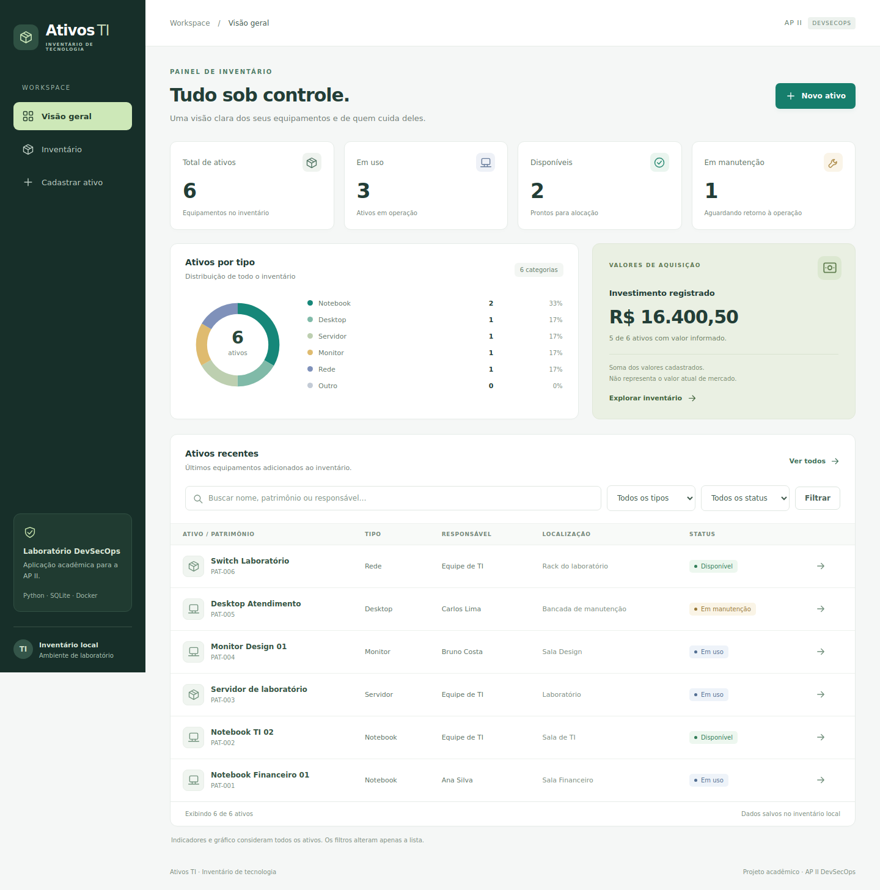

# Ativos TI · Painel de inventário

**Python · Flask · SQLite · Docker | AP II DevSecOps**

> Aplicação, esteira com testes e segurança, publicação Docker e deploy automático validados na VM em 15/10/2026.

Aplicação para controlar equipamentos, responsáveis, localização e valores de aquisição. Projeto acadêmico AP II DevSecOps.



## 🛠️ Como fazer — passo a passo

**[Abrir o guia completo: do ambiente ao deploy automático](docs/como-fazer.md)**

Aprenda a preparar a VM, conectar pelo PowerShell, executar o dashboard, acompanhar a esteira e validar o deploy. Cada etapa mostra onde executar, o comando, sua finalidade e o resultado esperado.

| Quero… | Onde encontrar |
| --- | --- |
| Reproduzir desde o início | [Guia completo](docs/como-fazer.md) |
| Usar o laboratório já instalado | [Uso diário](docs/como-fazer.md#9-uso-diário) |
| Entender a esteira e o Trivy | [Etapas da esteira](docs/como-fazer.md#6-entender-e-acompanhar-a-esteira) |
| Conferir o deploy automático | [Validação de ponta a ponta](docs/como-fazer.md#10-validar-uma-atualização-de-ponta-a-ponta) |
| Resolver um erro | [Problemas comuns](docs/como-fazer.md#13-problemas-comuns) |

## O que esta versão oferece

- Dashboard com total de ativos, disponíveis, em uso e em manutenção.
- Gráfico por tipo, calculado com os registros reais do banco.
- Soma dos valores de aquisição informados e quantidade de ativos com preço preenchido. Valores vazios não são tratados como zero.
- Inventário com busca por nome, patrimônio, responsável, localização, marca/modelo e série; filtros por tipo e status.
- Cadastro, ficha de detalhes, edição e remoção com confirmação.
- Nome, tipo, responsável e status obrigatórios; demais informações opcionais.
- Patrimônio preenchido deve ser único. Preços são armazenados em centavos inteiros, evitando erros de ponto flutuante.
- Interface responsiva em português, sem CDN, JavaScript ou serviços externos.

**Os indicadores sempre consideram o inventário inteiro; os filtros alteram somente a lista.** A visão geral exibe os oito últimos registros quando não há filtros. A página Inventário exibe todos os resultados.

## Arquivos e função

| Arquivo/pasta | Função |
| --- | --- |
| `app.py` | Rotas, validações, acesso ao banco, migração e cálculo do dashboard |
| `templates/` | Dashboard, cadastro, detalhes, edição, confirmação de remoção e erros |
| `static/style.css` | Layout e adaptação para telas pequenas |
| `tests/test_app.py` | Testes de comportamento, migração, valores e entradas |
| `Dockerfile` | Imagem Python + Flask + Gunicorn com usuário sem privilégios |
| `compose.yaml` | Primeira execução/build local, porta 8080 e volume persistente |
| `compose.deploy.yaml` | Execução da imagem aprovada com o volume existente |
| `deploy/` | Script de atualização e serviço/timer systemd |
| `.github/workflows/cadastro-ativos.yml` na raiz do repositório | Esteira com testes, Bandit, pip-audit, Trivy e publicação |

## Documentação

- [Arquitetura e persistência](docs/arquitetura.md)
- [Pipeline e deploy automático](docs/pipeline.md)
- [Controles e análise de segurança](docs/seguranca.md)
- [Validação realizada](docs/validacao.md)
- [Prévias desktop, ficha e celular](docs/preview/)

## Obter o código

```bash
git clone --branch feat/cadastro-ativos https://github.com/geovanniandrade/cybersecurity-labs.git
cd cybersecurity-labs/devsecops/cadastro-ativos
```

## Executar localmente

Python 3.12, no Linux:

```bash
python3 -m venv .venv
source .venv/bin/activate
python -m pip install -r requirements.lock
python -m unittest discover -s tests -v
flask --app 'app:create_app()' run --port 8080
```

Abra http://127.0.0.1:8080. Flask CLI é para desenvolvimento; o container usa Gunicorn.

## Docker

Os comandos abaixo são para a primeira execução. Depois de habilitar o updater, acompanhe o deploy pela [etapa de uso diário](docs/como-fazer.md#9-uso-diário) e não substitua a imagem aprovada por um build local.

```bash
docker compose up -d --build
docker compose ps
```

Na VM o acesso fica em `127.0.0.1:8080`. Para acessar pelo Windows, execute em outra janela do PowerShell e mantenha-a aberta:

```powershell
ssh -N -L 8080:127.0.0.1:8080 docker01@127.0.0.1 -p 2200
```

Abra http://127.0.0.1:8080 no Windows. O Juice Shop permanece separado na porta 3000.

## Atualização e persistência

Siga o [passo a passo de deploy](docs/como-fazer.md#7-preparar-a-imagem-aprovada-para-a-vm). O atualizador faz backup antes da troca e usa o volume `cadastro-ativos_ativos_data`.

A migração da versão inicial adiciona colunas sem apagar os registros ou alterar IDs e datas. Ativos antigos recebem status inicial **Disponível**; revise o status pela edição. Campos adicionais ficam vazios e valores ficam não informados.

Após reiniciar a aplicação, recarregue formulários antigos para obter uma nova sessão/CSRF.

**Não use `docker compose down -v`: essa opção remove o volume do Compose local e o banco.** Não publique bancos ou backups no Git.

## Remoção

Abrir a tela de remoção não exclui nada. A exclusão exige marcar a confirmação e enviar o formulário protegido por CSRF. A operação exclui definitivamente apenas o registro escolhido; a aplicação não tem lixeira.

## Validação e pendências

11 testes automatizados passaram, incluindo uma migração a partir do esquema da versão inicial. Cadastro, edição, busca e remoção também foram verificados no navegador Chromium em uma aplicação servida por Gunicorn; layout inspecionado em desktop e celular. Os testes usam bancos temporários. Os dados de demonstração usados na prévia não são inseridos automaticamente.

A execução [#11 do Actions](https://github.com/geovanniandrade/cybersecurity-labs/actions/runs/38828875060) concluiu testes, scanners, build e publicação. O commit `0b608c6` foi confirmado na VM com container healthy e timer ativo. Foram identificados achados reais no pip e em bibliotecas embutidas; o pip foi removido da imagem final. A aprovação do Trivy segue o critério HIGH/CRITICAL com correção disponível, não uma declaração de ausência de vulnerabilidades.

A aplicação destina-se ao laboratório local, sem autenticação. O relatório acadêmico final, a consolidação das evidências e o vídeo continuam sendo entregáveis separados.

## Referências

- [SQLite com Flask](https://flask.palletsprojects.com/en/stable/tutorial/database/)
- [Gunicorn com Flask](https://flask.palletsprojects.com/en/stable/deploying/gunicorn/)
- [Backup SQLite em Python](https://docs.python.org/3/library/sqlite3.html#sqlite3.Connection.backup)
